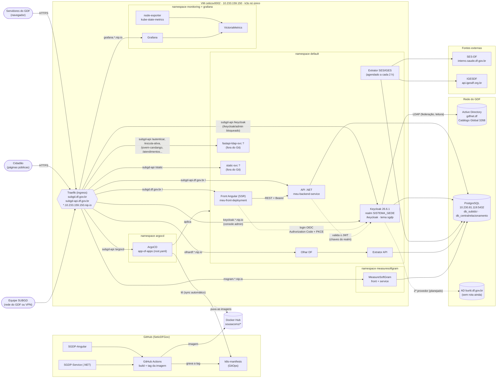
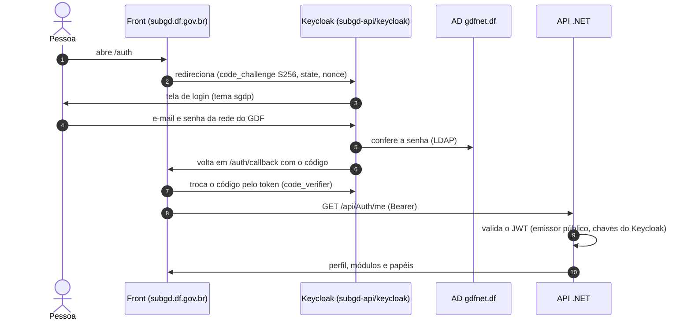
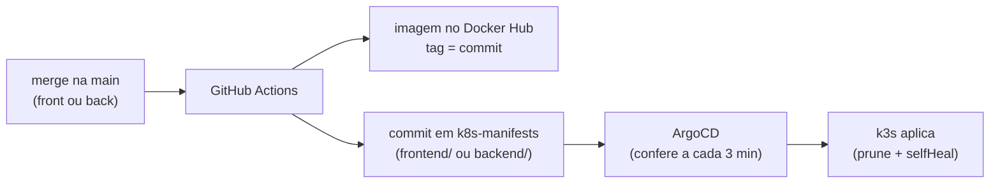

# Arquitetura do SGDP (esboço)

Esboço inicial, para ir completando. O GitHub desenha os diagramas abaixo (Mermaid); para
editar, basta mudar o texto. Itens marcados com "?" ainda precisam ser confirmados.

## Visão geral

## Login (OIDC)

## Entrega contínua (GitOps)

## A completar

- O que são `fastapi-ldap-svc` e `static-svc`: estão no ingress do `subgd-ingress`, mas não têm
  manifesto no repositório.
- Se o Keycloak e a API usam o mesmo servidor PostgreSQL (o Keycloak lê do secret `db-credentials`).
- MCP do SGDP e testes e2e (ainda pelo login antigo, `/api/Auth/token`).
- Backups (banco, volumes do Grafana e do VictoriaMetrics).
- Segundo provedor LDAP gravável (OU no domínio raiz, StartTLS 389) para senha temporária.
