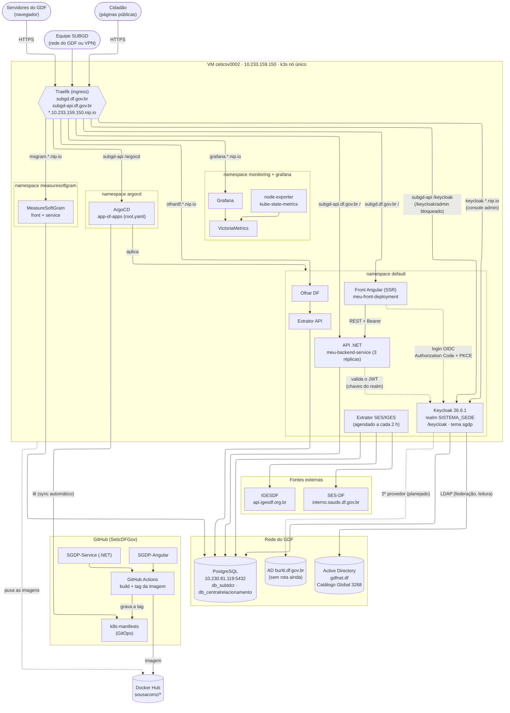
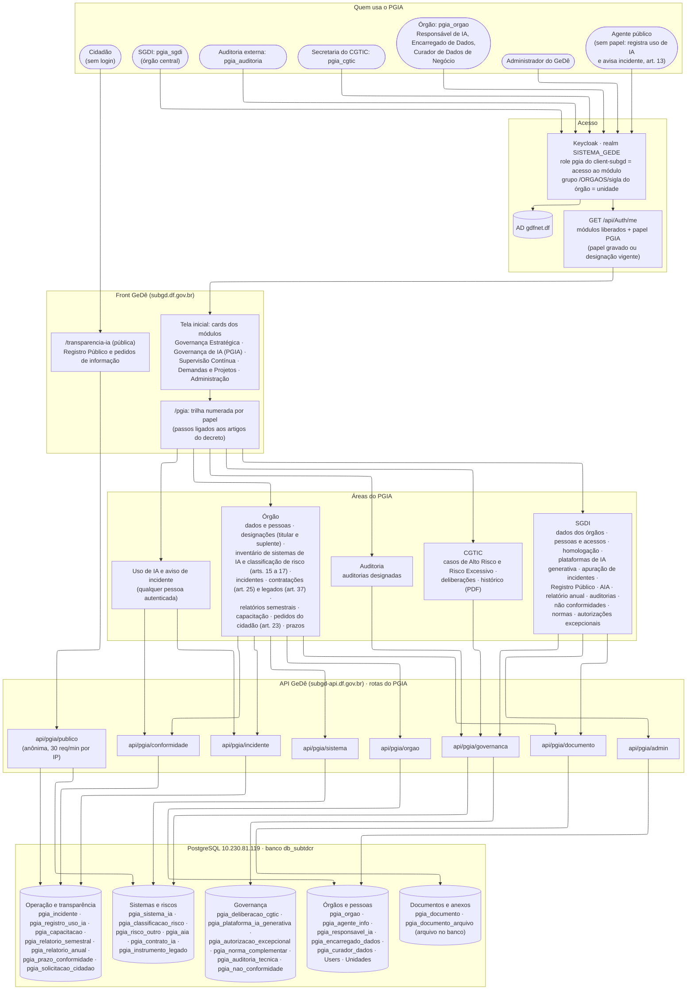
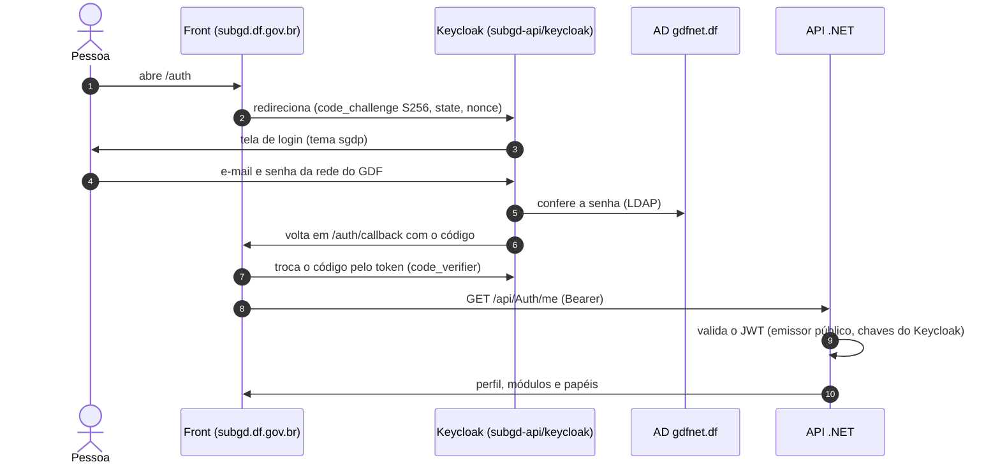
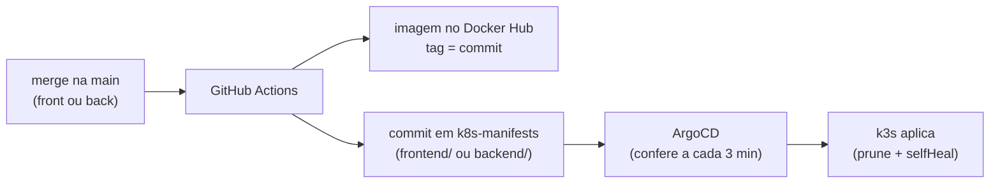

# Arquitetura do ambiente da VM ceticsv0002

Aplicações e serviços da SUBGD que rodam na VM ceticsv0002 (k3s): o GeDê e os demais
sistemas do mesmo servidor. O GitHub desenha os diagramas abaixo (Mermaid); para editar,
basta mudar o texto.

 O GitHub desenha os diagramas abaixo (Mermaid); para
editar, basta mudar o texto.

## Visão geral

## GeDê e o módulo PGIA

O GeDê é uma das aplicações do ambiente. O módulo de Governança de IA (PGIA, Decreto nº
48.901/2026) concentra a maior parte das regras e dos dados dele.

## Login (OIDC)

## Entrega contínua (GitOps)

